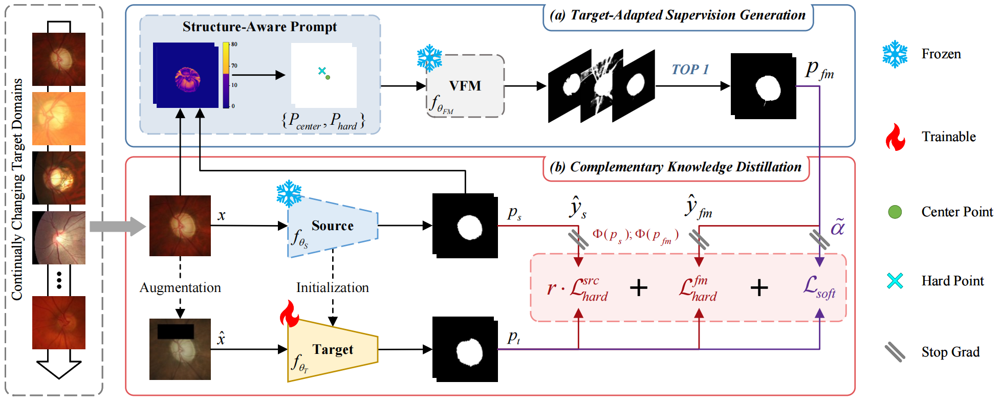

# 📄 ReDi-FM

Official PyTorch implementation of our IJCAI 2026 paper "[ReDi-FM: Frozen Foundation Model for Continual Test-Time Adaptation in Medical Image Segmentation](https://ijcai.org/proceedings/2026/140)".

<div align="center">
  
</div>

## Environment

```text
CUDA 11.8
Python 3.9.7
PyTorch 2.2.2
torchvision 0.17.2
torchaudio 2.2.2
```

Create the environment and install the dependencies from the repository root:

```bash
conda create -n ReDi-FM python=3.9.7
conda activate ReDi-FM
conda install pytorch==2.2.2 torchvision==0.17.2 torchaudio==2.2.2 pytorch-cuda=11.8 -c pytorch -c nvidia
pip install -r requirements.txt
```

## Data Preparation

The preprocessed OD/OC and polyp data can be downloaded from the [Google Drive](https://drive.google.com/drive/folders/1axgu3-65un-wA_1OH-tQIUIEHEDrnS_-?usp=drive_link) provided by [VPTTA](https://github.com/Chen-Ziyang/VPTTA).

For prostate segmentation, we use the data preprocessed by [SynFoC](https://github.com/MQinghe/SynFoC) and generate the corresponding CSV files. Our prepared data and CSV files can be downloaded from [Google Drive](https://drive.google.com/file/d/1b1qsZ5ZkkbSDD8VBYV8As8RsMYVeQQv-/view?usp=sharing).

## Pre-trained Models

- **Source models.** Download the [trained segmentation models](https://drive.google.com/drive/folders/16MbFbLj3vkL89E7KwUjIWB-PV5F3GfmU?usp=drive_link). Set `--model_root` to the directory containing the source-domain folders for your task. Each folder should contain `last-Res_Unet.pth` for OD/OC and prostate segmentation or `last-segformer.pth` for polyp segmentation.
- **Backbone weights for source training.** Download the [ResNet and SegFormer weights](https://drive.google.com/file/d/1Ffj3IlNk91zIfXEDYTSDkQ0yCjsg7tQz/view?usp=sharing). For ResNet-34, set `hub_dir` to the weights directory in [OPTIC_SAM/networks/resnet.py](OPTIC_SAM/networks/resnet.py#L8) and [Prostate_SAM/networks/resnet.py](Prostate_SAM/networks/resnet.py#L8) (line 8 in both files). For SegFormer-B0, set the full path to `segformer_b0_backbone_weights.pth` in [polyp_SAM/networks/segformer/backbone.py](polyp_SAM/networks/segformer/backbone.py#L494) (line 494).
- **SAM for test-time adaptation.** Download Meta's [SAM ViT-H checkpoint](https://dl.fbaipublicfiles.com/segment_anything/sam_vit_h_4b8939.pth) and set `--sam_root` to the full path to `sam_vit_h_4b8939.pth`.

Before running any script, activate the environment and replace the hard-coded Python interpreter with `python`. Update the code, dataset, checkpoint and log paths for your machine. Run commands from the repository root.

To train your own source models, use the script for your task. Use the same directory for training's `--path_save_model` and evaluation's `--model_root`.

```bash
bash OPTIC_SAM/train_source.sh    # OD/OC, ResUNet-34
bash Prostate_SAM/train_source.sh # Prostate, ResUNet-34
bash polyp_SAM/train_source.sh    # Polyp, SegFormer-B0
```

## How to Run

**Source Only**

```bash
bash OPTIC_SAM/baseline_only_source.sh
bash Prostate_SAM/baseline_only_source.sh
bash polyp_SAM/baseline_only_source.sh
```

**ReDi-FM**

```bash
bash OPTIC_SAM/ReDi-FM.sh
bash Prostate_SAM/ReDi-FM.sh
bash polyp_SAM/ReDi-FM.sh
```

## Citation ✏️

If this code is helpful for your research, please cite:

```bibtex
@inproceedings{ijcai2026p140,
  title     = {ReDi-FM: Frozen Foundation Model for Continual Test-Time Adaptation in Medical Image Segmentation},
  author    = {Ji, Jianhang and Cheng, Zhiming and Zhao, Jianxiang and Wang, Tingyu and Ma, Bingtao and Gao, Yuhan and Ying, Zuobin and Wang, Shuai},
  booktitle = {Proceedings of the Thirty-Fifth International Joint Conference on
               Artificial Intelligence, {IJCAI-26}},
  publisher = {International Joint Conferences on Artificial Intelligence Organization},
  editor    = {Diego Calvanese},
  pages     = {1252--1260},
  year      = {2026},
  month     = {8},
  note      = {Main Track},
  doi       = {10.24963/ijcai.2026/140},
  url       = {https://doi.org/10.24963/ijcai.2026/140},
}
```

## Acknowledgement

Parts of the code are based on the PyTorch implementations of [VPTTA](https://github.com/Chen-Ziyang/VPTTA) and [Segment Anything (SAM)](https://github.com/facebookresearch/segment-anything). We also thank [SynFoC](https://github.com/MQinghe/SynFoC) for providing the preprocessed prostate data.

## Contact

Jianhang Ji (jijianhang.ai@gmail.com)
